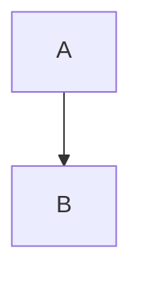

# Heading

A wiki link [[Note]] with display [[Note|the label]], a heading link
[[Note#Section]] and a block link [[Note#^blk-1]].

An embed ![[diagram.png]] and a note embed ![[Other Note]].

Tags: #alpha #nested/beta and #v2.

> [!warning] Watch out
> This is a callout body.

Inline math $E = mc^2$ and a block:

$$
\int_0^1 x^2 \, dx
$$



A [markdown link](https://example.com/docs) too.

Inline `code with [[ignored]] and #ignored` here.

```rust
// [[also ignored]] #ignored
fn main() {}
```

A block ref here ^ref-42
